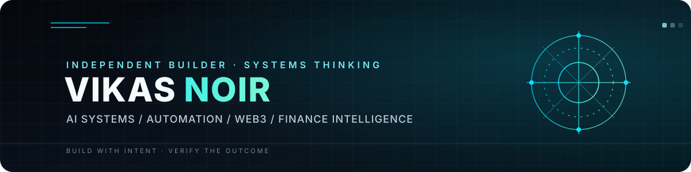

  

  <h3>Building systems that don't just act — they verify.</h3>
  

    <strong>AI Systems · Automation · Web3 Research · Finance Intelligence</strong>
  

  

    I explore the engineering behind useful intelligence: tool orchestration, durable state,
    evidence-aware workflows, and safer execution under uncertainty.
  

  

    
    
    
  

---

## The direction

I’m working toward software that connects reasoning to real execution without hiding uncertainty. That means treating planning, tool use, state, permissions, failure recovery, and verification as one engineering problem—not as disconnected features.

### Current build

| Area | What I’m exploring |
|---|---|
| **AI orchestration** | Routing work across tools and model providers, with explicit capability boundaries |
| **Autonomous workflows** | Bounded missions, durable task state, observable outcomes, and safe recovery |
| **Engineering systems** | Reproducible tests, exact-commit evidence, release gates, and regression-driven fixes |
| **Finance & Web3** | Market structure, liquidity, derivatives, on-chain research, and evidence provenance |
| **Simulation & systems** | Deterministic models, scenario analysis, and clear separation between simulation and real-world observation |

## Selected work

### ARBUS OMEGA
A technical-intelligence platform in active development, focused on governed tool execution, persistent context, research, automation, and verification. The project is still being validated; release-readiness claims are tied to test evidence, not just feature presence.

### MARK LIII
A finance-intelligence direction for bringing market structure, liquidity, derivatives, on-chain context, and catalysts into a coherent research workflow. Live-data capabilities depend on configured and available providers.

## Engineering principles

- **Evidence over appearance.** A green badge or a file in the repository is not a substitute for a reproducible result.
- **Unknown is a valid state.** Missing credentials, unavailable providers, and ambiguous outcomes should be visible—not guessed away.
- **Safe execution first.** Permissions, postconditions, idempotency, and recovery belong in the design from the beginning.
- **Progress must survive context loss.** Decisions, current state, test results, and next actions should be written down and recoverable.
- **Build breadth on a proven core.** A smaller system that reliably completes real tasks is more valuable than a large collection of disconnected modules.

## Tools & working areas

  
  
  
  
  

## A note on the work

This profile reflects an engineering direction and work in progress—not a claim that every planned capability is production-ready. I aim to publish work with clear boundaries, honest status, and evidence that others can inspect.

  VIKAS NOIR · BUILD WITH INTENT · VERIFY THE OUTCOME

